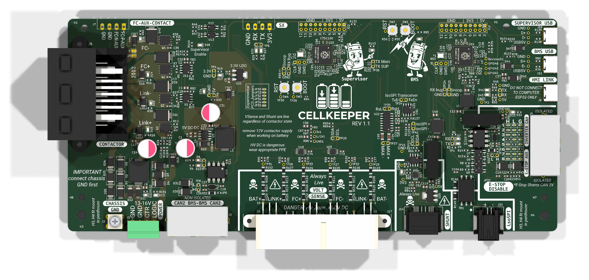
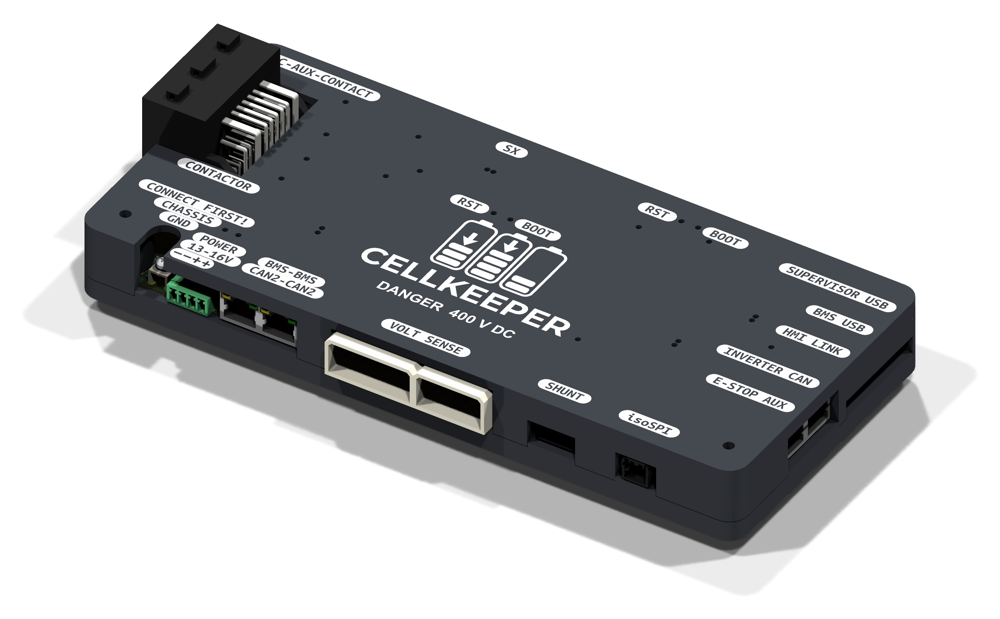

# CellKeeper BMS — v1.1

KiCad PCB design for the **CellKeeper Battery Management System**, a replacement BMS controller for battery packs using the isoSPI protocol.

## Overview

- **MCU:** Raspberry Pi RP2354B (dual Cortex-M33 @ 150 MHz)
- **Current sensing:** TI INA228 (20-bit ADC, shunt-based)
- **Pack voltage:** 6-channel monitoring via precision dividers
- **BMB communication:** isoSPI master with galvanic isolation (Manchester encoding via PIO)
- **CAN bus:** 500 kbps, hardware transceiver
- **Contactor control:** 4-channel PWM outputs with inrush limiting
- **Input:** 12 V nominal; rated for up to 400 V DC pack voltage

## Repository Contents

Three boards, each its own KiCad project. They share no copper: the hat and the precharge board
connect to the rest of the system by wires and lugs.

| Path | Description |
|------|-------------|
| `CellKeeper/` | Main controller board (`CellKeeper.kicad_pro`), with its `production/` outputs |
| `isoSPI-Hat/` | isoSPI hat for a Raspberry Pi Pico: SP3485 / AM26LV32 / HM2113 transformer to the BMB connector |
| `Precharge/` | Precharge board: six PTCs (three parallel strings of two) between M8 lugs, plus the HV system wiring diagram |
| `lib/` | Shared `CellKeeper_Local` symbol and footprint libraries and `CellKeeper.3dshapes` 3D models |
| `enclosure/` | 3D-printable case for the main board (build123d), with print-ready STEP/STL files |
| `graphics/` | Silkscreen artwork and images |
| `python_scripts/` | Utility scripts |

## Enclosure

A two-part printed case (base tray and lid) for the main board, generated by
`enclosure/cellkeeper_case.py`. It mounts in the penthouse on the original HVC brackets. The lid
carries the logo and connector labels, which can be printed as a contrasting-colour inlay, with
clear light pipes over the LEDs. Ready-to-print STEP and STL files are in `enclosure/output/print/`.
The board shows the case in KiCad's 3D viewer through the `ENC1` footprint.

## Getting Started

1. Install [KiCad 10.0+](https://www.kicad.org/download/)
2. Clone this repository
3. Open the board's `.kicad_pro` in `CellKeeper/`, `isoSPI-Hat/` or `Precharge/`. Each project's
   `sym-lib-table` / `fp-lib-table` load the shared libraries from `../lib`.

To order the boards on one panel, panelise the finished boards at order time (e.g. with KiKit)
rather than merging the projects again.

## Safety

⚠️ This board interfaces with 400 V battery packs that can deliver **lethal** current. Only qualified personnel should work on high-voltage systems. This is a v1.1 development design — untested, no warranty, use at your own risk.

## Acknowledgments

- **Damien Maguire & Tom de Bree** — Original BATMan BMS software

## License

GPL-3.0 — see [LICENSE](LICENSE).
